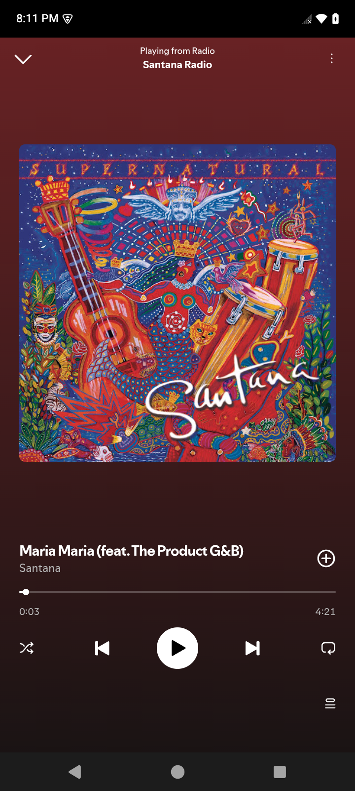

# Music and podcast player

An independent, mobile-focused music and podcast player with playlist and library management, podcast browsing, playback controls, and offline downloads. Playback and offline reopening have been tested on an iPhone; further device testing remains in progress.



## Code sample

This repository shares the playlist draft and playback queue models with their tests, not the complete application. The playlist model keeps duplicate recordings distinct and supports removal, grouped reordering, undo, and redo. The playback queue handles playback order, explicit additions, shuffle, and restoring queue state.

Run the tests with Node.js:

```sh
npm test
```
